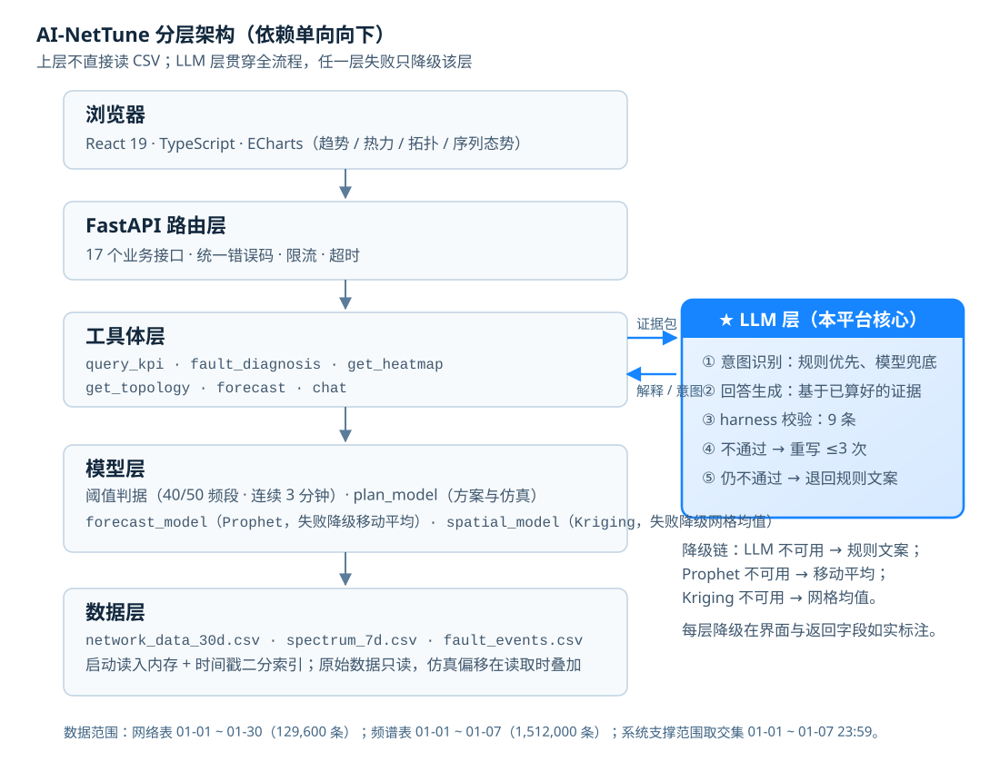

# AI-NetTune

**基于 LLM 意图驱动的多模态无线网络智能分析与管控平台**

> 🌐 **在线预览**：<https://ai-net-dgut.github.io/AI-NetTune/> ｜ ⚡ **本地部署**：[快速开始](#快速开始) ｜ 📄 **部署细节**：[DEPLOY.md](DEPLOY.md)
> 在线版只托管前端静态页；**提问、研判、方案仿真、分析记录等功能需要后端**，请按快速开始的第 2~4 步本地启动。

面向**网络测试与优化人员**的多接入点无线组网（5G 现网 / 校园 / 商场等）场景 Web 智能管控平台：**以自然语言为唯一入口**，用户一句话即可完成"找对象 → 查证据 → 判故障 → 给方案 → 看效果 → 可回滚"的完整链路；融合位置感知与电磁频谱预测（区域信号/频谱态势预测）**提前预警**；以**文本、图表、地图、拓扑及序列态势图**多模态呈现网络状态（非专业用户亦可看懂）。

> **大模型在这里做什么**：听懂口语化问题（规则兜底）、把算好的证据写成**整段可读回答**、并把多步分析**编排成一条链路**；所有数字由确定性工具计算，模型输出的每个数字都经 harness 校验。
> **边界如实说明**：配置生效只覆盖**网络 KPI**（频谱预警仍基于原始频谱）；当前为**仿真内闭环**，不下发真实设备。

---

## 项目简介

本项目将大语言模型（LLM）智能体意图驱动思想迁移至无线网络监测与管控领域，主受众为**网络测试与优化人员**：

* **数据层**：支持仿真数据生成与 CSV 导入，覆盖多接入点组网监测场景（当前数据集为 3 个 AP + 3 条移动用户轨迹，逐分钟采样；18 维数据字典：核心 KPI + AP/UE 坐标 + 故障深度分析辅助字段，含网络状态标签，见 [docs/data_dict.md](docs/data_dict.md)）；多日时间跨度 + 坐标字段已就绪，支撑拓扑可视化与时空分析；

* **智能层**：通信 KPI 语义层将 RSRP、SINR、吞吐量等专业指标翻译为自然语言；多 KPI 联合研判引擎结合通信专业知识输出**可解释**的故障结论（覆盖故障 / 网络拥塞 / 边缘弱信号，多候选原因与支持/反证证据链）与**处置恢复建议**；融合历史与实时数据预测未来电磁频谱态势（区域信号/频谱态势预测）并**提前预警**；采用 **Model-free 免建模架构**——不依赖信道与传播模型，直接以历史与实时数据驱动预测与优化，规避建模误差；

* **交互层**：用户通过自然语言提问，即可完成数据查询、故障研判、报告导出，输出**文本、图表、地图、拓扑及序列态势图多模态**研判结果；

* **可靠性**：大模型只做"理解与表达"，全部数值由确定性工具计算；模型写出的回答还要过 **9 条 harness 校验**（数字/对象/断言/结构/参数/方向/方案名/效果值），不通过就退回规则文案并**如实显示原因**。大模型 API 不可用时，判据、图表、告警、方案仿真等核心功能**全部可降级使用**。

## 大模型在本项目中的位置（LLM 意图驱动能力）

很多项目的"LLM"只是末尾加一段润色文案，我们把它做成了**贯穿全链路的三个能力层**：

| 能力层 | 具体做什么 | 没有它时 | 界面证据 |
|---|---|---|---|
| **① 听懂**（意图识别） | 把口语化问题映射到 6 个工具之一：`fault_diagnosis` / `query_kpi` / `get_heatmap` / `get_topology` / `forecast` / `chat` | 只能匹配关键词：`为什么 AP-02 信号差` 能中，`我这边上网老是断断续续的` 就落空 | 徽标 **`意图·规则`** / **`大模型识别`**，悬停显示命中方式或降级原因 |
| **② 写清**（回答生成） | 基于**已算好的证据**写整段回答：【结论】【依据】【方案】【预计效果】【前提与风险】 | 只能输出四段模板文字，术语堆砌、不连贯 | 标题 **`AI 研判 · 数字已核对`** |
| **③ 编排**（多步链路） | 复合问法自动拆成多步：`哪个 AP 最差，未来 3 小时会怎样` → 找对象 → 查证据 → 看 180 分钟风险 → 给方案 | 用户要问 2~3 次才能凑齐结论 | 回答里的**步骤条**（每步含结论与依据）|

### 关键设计：模型不负责"算数"

```
用户一句话
   ├─ ① 意图识别（规则优先 → 未命中才调模型）
   ├─ ② 工具执行：取数 → 阈值判据 → 候选原因 → 方案 → 预测（**数字全在这里算**）
   ├─ ③ 回答生成：只把"算好的证据"交给模型，让它组织语言
   ├─ ④ harness 校验（answer_llm.verify）
   └─ ⑤ 通过 → 展示；不通过 → 重写 ≤3 次 → 仍不通过则退回规则文案并标注原因
```

**9 条 harness 校验**（`answer_llm.py`）：

| # | 校验 | 拦截的例子 |
|---|---|---|
| 1 | 数字必须来自证据 | 证据是 −111.06 dBm，模型写 −95.2 → 拒 |
| 2 | 对象必须来自证据 | 证据里没有 AP-09，模型写了 → 拒 |
| 3 | 无根因证据时禁确定性断言 | "已确认根因是倾角不足" → 拒（但"**不能**视为已确认根因"放行）|
| 4 | 必须含【结论】【依据】【方案】 | 只写一段话 → 拒 |
| 5 | 长度上限 | 灌水超长 → 拒 |
| 6 | 参数调整必须与证据一致 | 证据 8°→5°，模型写 8°→6° → 拒 |
| 7 | 方向不能写反 | "提升 −3.6 dB" → 拒（"提升至 −107.46 dBm"放行）|
| 8 | 不得自造方案名 | 证据只有 2 个方案，模型编第三个 → 拒 |
| 9 | 效果数值必须来自证据 | 证据 `+3.6 dB`，模型写 `+9.9 dB` → 拒 |

> 失败不是"悄悄换成模板"，而是把 `answer_check{violations, source, attempts}` 一起返回，界面有「**AI 文本状态**」折叠可查——**不把规则文案伪装成大模型输出**。

### 分层降级：任一层失败只影响该层

| 层 | 正常 | 降级时 | 是否可见 |
|---|---|---|---|
| 意图 | 模型识别（`大模型识别`）| 规则命中（`意图·规则`）/ 规则兜底（`意图·兜底`）| ✅ 徽标 + 原因 |
| 回答 | 模型整段（`AI 研判 · 数字已核对`）| 规则四段文案 + 违规原因 | ✅ 折叠可查 |
| 方案解读 | 模型改写（`由大模型生成`）| 模板（`模板生成`）| ✅ 标注 |
| 预测 | Prophet（`method=prophet`）| 移动平均（`moving_average`）/ 数据不足（`no_data`）| ✅ 字段如实返回 |

> 一句话概括这套设计：**规则算数、模型组句、校验器把关**。

## 项目价值

不止"看得见"，更要"能处置、有效益"：

* **快速定位**：多 KPI 联合研判定位故障区域（覆盖异常 / 拥塞 / 边缘弱信号），输出多候选原因与证据链及处置恢复建议，缩短排障时间；

* **提前预警**：基于历史与实时数据预测未来电磁频谱态势，故障发生前预警，变"事后排障"为"事前防范"；

* **动态管理**：依据实时状态与用户需求制定配置调整方案，形成"监测—分析—决策—优化"闭环，支持方案对比验证，改善网络质量、提升用户体验。

## 功能特性

**以大模型为核心的能力（详见上一节）**

* ✅ **自然语言即入口**：一句话完成"找对象 → 查证据 → 判故障 → 给方案 → 看效果 → 可回滚"，无需逐项点菜单
* ✅ **口语化意图识别**：规则优先、模型兜底；`我这边上网老是断断续续的` 这类不含关键词的说法也能落到"故障研判"
* ✅ **整段回答由模型撰写**：模型基于**已算好的证据**写【结论】【依据】【方案】【预计效果】【前提与风险】，界面标 **`AI 研判 · 数字已核对`**
* ✅ **9 条 harness 校验**：数字/对象/断言/结构/长度/参数一致/方向/方案名/效果值，任一条不过即重写（≤3 次），仍不过则退回规则文案并**显示违规原因**
* ✅ **复合问法自动编排**：`哪个 AP 最差，未来 3 小时会怎样` → 自动多步（找对象 → 查证据 → 看 180 分钟风险 → 给方案）
* ✅ **失败可观测**：`意图·规则` / `大模型识别` / `规则兜底` 三种徽标 + 「AI 文本状态」折叠，**从不把规则文案伪装成模型输出**

**观测与可视化**

* ✅ 通信 KPI 可视化（折线图 / 信号热力图 / 网络拓扑图 / 频谱地图）
* ✅ **多接入点拓扑图**：3 个基站（AP）与 3 条移动用户轨迹（UE）的位置分布、连接关系；点选 UE 查看信号 / 干扰 / 速率参数
* ✅ **区域电磁频谱视图**：区域信号质量热力分布（各区域频谱态势一览）
* ✅ **真实 vs 预测对比图**：历史真实帧与预测帧并排对比（Signal / Interference / Rate）+ MAE / RMSE 误差指标
* ✅ 区域信号质量预测与信号导航指引（位置感知 + 电磁频谱分析），故障**提前预警**（预计越阈时刻为**趋势估计**，界面如实标注）

**研判与闭环**

* ✅ 多 KPI 联合故障研判：输出"故障类型 → 证据链 → 候选原因（多候选 + 支持/反证）→ 处置建议"
* ✅ 方案与仿真对比：同段历史基线上比较"调整前 / 调整后"，参数可编辑、可应用到**仿真网络**、可一键回滚
* ✅ 监测→定位→处置闭环：**仿真内闭环**（不向真实设备下发配置），每次配置变更都有版本与回滚记录
* ✅ 分析记录：一次提问对应一条记录，证据与仿真明细嵌套其下，支持搜索与导出

**工程**

* ✅ 时序预测：**Prophet**（缺依赖自动降级移动平均），输出逐点置信区间与真实 MAE/RMSE。**LSTM 未实现**：30 天数据（单序列 720 小时点 / 4.3 万分钟点）足以训练曲线，但**故障事件仅 8 次、AP 仅 3 个**，事件级正样本不足以训练与验证，且引入 PyTorch（200 MB+）会抬高部署门槛。**未来接入真实数据后的路径已规划**：先补齐基线（季节性朴素 / 线性回归 / GBDT）→ 再上 LSTM，用**滚动回测**与 Prophet 同口径比较，**显著更优才切换**，否则保持 Prophet 主线
* ✅ 分析报告导出（Markdown / HTML，含图与数据表）
* ✅ 仿真数据生成 + CSV 导入
* ✅ React + TypeScript 前端（首页 / 工作台 / 分析记录三页，与后端业务接口联动）

## 技术架构

**分层与依赖方向**（单向向下，上层不直接读 CSV）：



> 图为矢量图（[architecture.svg](docs/brand/architecture.svg)），可无损缩放，也可直接用于 Word/PPT。
> 各层的工具名、阈值、数据文件与降级链已标注在图中。

LLM 层是这套架构里唯一"非确定性"的一层，因此单独展开：**如何理解问题、如何写回答、如何被校验、失败如何降级**，
详见上文 [大模型在本项目中的位置](#大模型在本项目中的位置为什么叫llm-意图驱动)（含 9 条 harness 校验与分层降级表）。

## 技术栈

| 层级       | 技术                                                         |
| ---------- | ------------------------------------------------------------ |
| 前端       | React + TypeScript + ECharts（graph 拓扑 / heatmap 热力 / bar+line 对比图） |
| 后端       | Python + FastAPI + Uvicorn                                   |
| **AI（核心）** | **大模型（GLM-4-Flash / DeepSeek 均可，OpenAI 兼容接口）**：意图识别（规则优先、模型兜底）+ 整段回答生成 + 复合问法编排；**配套 harness 校验器**（9 条）保证输出数字可回溯 |
| 感知与预测 | 位置感知 + 电磁频谱分析（区域信号质量预测 / 信号导航指引）+ 时序预测（ **Prophet** ，移动平均仅作 baseline）；本阶段不采用 LSTM：事件样本与 AP 数量不足，待真实数据接入后按"基线 → LSTM → 滚动回测择优"逐步替换 |
| 数据       | CSV（pandas 读取，18 维数据字典，含 AP/UE 坐标与故障深度分析字段） |

## 快速开始

> **🌐 在线预览**：<https://ai-net-dgut.github.io/AI-NetTune/>
> GitHub Pages 只托管**前端静态页**；提问、研判、方案仿真等功能需要后端服务，因此"看界面"用在线版，"跑功能"请按下面的本地部署操作。
> 数据文件不在仓库里（约 120 MB），**部署前必须先放数据**；服务器部署、反向代理与环境变量见 [DEPLOY.md](DEPLOY.md)。

### 三种使用方式

| 方式 | 需要什么 | 能做什么 | 适用场景 |
|---|---|---|---|
| **A. 在线预览** | 浏览器 | 浏览界面、图表与说明页（后端未连时数据类操作会失败提示）| 快速看效果、评审截图 |
| **B. 本地完整部署** ⭐ | Python + Node + 数据 | **全部功能**：提问、研判、方案、仿真闭环、分析记录、报告导出 | 演示、答辩、开发 |
| **C. 服务器部署** | 服务器 + Nginx | 公网可访问的完整演示 | 多人联调、外网演示（见 DEPLOY.md）|

### 前置检查（30 秒）

| 组件 | 要求 | 说明 |
|---|---|---|
| **Python** | **≥ 3.10**（本项目在 3.13.10 验证）| 代码使用 `str \| None` 等 3.10+ 语法，**3.9 会直接 `TypeError` 起不来** |
| **Node.js** | **≥ 20** | 前端 Vite 构建与开发服务器 |
| **数据** | 约 120 MB | `data/network_data_30d.csv`（14.6 MB）+ `data/spectrum_7d.csv`（103.4 MB）|

```powershell
python --version     # 期望 ≥ 3.10，例如 Python 3.13.10
node --version       # 期望 ≥ 20
python scripts/doctor.py    # 环境+数据一键自检，退出码 0 = 可以启动
```

> Windows 上装了多个 Python？优先用 `powershell -ExecutionPolicy Bypass -File scripts\start_backend.ps1`，
> 它会自动挑 ≥3.10 的解释器并检查数据与依赖。

### 第 1 步：放数据

把两个 CSV 放到项目根目录的 `data/` 下：

| 文件 | 大小 | 用途 |
|---|---|---|
| `network_data_30d.csv` | 14.6 MB | 网络 KPI 主表（129,600 条 × 18 列，01-01 ~ 01-30）|
| `spectrum_7d.csv` | 103.4 MB | 频谱表（1,512,000 条 × 9 列，01-01 ~ 01-07），预测预警用 |

```powershell
python scripts/doctor.py            # 再次自检，应显示数据 ok
```

若文件名带浏览器后缀（如 `network_data_30d(1).csv`），运行 `python scripts/prepare_data.py --apply` 规范化
（不规范也能启动，后端候选名兼容）。

### 第 2 步：启动后端（约 1 分钟）

```powershell
# ① 建议用虚拟环境（可选，但能避免污染全局环境）
python -m venv .venv
.\.venv\Scripts\Activate.ps1          # Linux / macOS: source .venv/bin/activate

# ② 安装依赖
python -m pip install -r requirements.txt
#    装不上 prophet / PyKrige 时，用最小依赖（功能自动降级，服务仍可启动）：
#    python -m pip install -r requirements-min.txt

# ③ 启动（局域网联调用 0.0.0.0；本机自用可用 127.0.0.1）
python -m uvicorn main:app --reload --host 0.0.0.0 --port 8000
```

**成功标志**：终端先打印「启动自检」横幅（数据行数、prophet/kriging/llm 能力状态），最后一行是
`Uvicorn running on http://0.0.0.0:8000`。

**验证后端**（另开一个窗口）：

```powershell
(Invoke-RestMethod http://127.0.0.1:8000/api/health).data.ok     # 期望 True
#   Linux/macOS: curl -s http://127.0.0.1:8000/api/health
```

浏览器打开 <http://127.0.0.1:8000/docs> 可看 Swagger 接口面板。

> 端口被占用时换端口：`--port 8001`（前端也要相应设置 `VITE_PROXY_TARGET=http://127.0.0.1:8001`）。

### 第 3 步：启动前端（约 1 分钟）

```powershell
cd frontend
npm install
npm run dev
```

**成功标志**：终端输出 `VITE vX.X.X ready` 与 `Local: http://localhost:5173/`。

开发模式通过 `vite.config.ts` 的 proxy 把 `/api` 转发到 `http://127.0.0.1:8000`；后端换了端口就设 `VITE_PROXY_TARGET`（见 [frontend/.env.example](frontend/.env.example)）。
`npm run build` 的产物**不带代理**，需用 `VITE_API_BASE` 或反向代理，见 [DEPLOY.md](DEPLOY.md) 第 6 节。

### 第 4 步：验证全链路（30 秒）

1. 打开 <http://localhost:5173/>
2. 进入「**网络工作台**」→ 点案例 **「AP-02 弱覆盖案例 01-01 10:00 开始」**
3. 点「**发送**」

| 位置 | 期望结果 |
|---|---|
| 左侧研判区 | 出现「研判结论 / 判断依据 / 原因与限制 / 处理与预估」并可点证据链接 |
| 右上角入口 | `预测预警 N 项（未检出风险）`——**不开弹窗也会自动检查** |
| 提问徽标 | `意图·规则`（未配模型）/ `大模型识别`（已配模型）|

### 第 5 步：接入大模型

不配也能跑（自动降级为规则，`source` 字段如实标 `rule`）。配好后规则未命中的提问、
预测/方案解释与**研判整段回答**改由模型生成（单次约 2~5 秒）。

| 服务 | `LLM_URL` | `LLM_MODEL` |
|---|---|---|
| DeepSeek（默认）| 留空即默认 | `deepseek-chat` |
| 智谱 GLM | `https://open.bigmodel.cn/api/paas/v4/chat/completions` | `glm-4-flash` |

```powershell
setx LLM_API_KEY "你的key"                       # 设置后必须重开终端
setx LLM_MODEL "glm-4-flash"                     # 用 GLM 时再加下面一行
setx LLM_URL "https://open.bigmodel.cn/api/paas/v4/chat/completions"

### 遇到问题

| 现象 | 常见原因 | 解决 |
|---|---|---|
| `python scripts/doctor.py` 退出码非 0 | 解释器 <3.10 / 依赖缺失 / 数据未放 | 按上面的提示逐项修；Windows 用 `start_backend.ps1` |
| 后端启动但 `/api/health` 的 `data.ok=false` | 数据文件名不对或不在 `data/` | `python scripts/prepare_data.py --apply` 后重启 |
| 启动日志出现 `prophet=off` / `kriging=off` | 没装 prophet / PyKrige | 不影响使用：自动降级移动平均 / 网格均值；要全功能就补装 |
| 前端页面报 502 / 一直转圈 | 后端没起，或端口与 `VITE_PROXY_TARGET` 不一致 | 先确认 <http://127.0.0.1:8000/api/health> 可访问 |
| 页面提示"预测接口尚未接入（HTTP 404）" | 后端是旧版本或未启动 | 重启后端，确认 `/api/forecast/preview` 可用 |
| 徽标一直是 `意图·规则`、AI 文本不出现 | 后端进程没读到 key | 重开终端 → 重启后端；展开「AI 文本状态」看具体原因 |
| 端口 8000 被占用 | 已有实例在跑 | 换 `--port 8001`，前端设 `VITE_PROXY_TARGET=http://127.0.0.1:8001` |

### 数据范围说明（重要）

> 接口 1/2/3/5/6/9 读取 `data/` 下的网络表（30 天版，129,600 条 × 18 列）；
> 接口 11/12（预测预警）额外读取 103.4 MB 的 `spectrum_7d.csv`（1,512,000 条 × 9 列）。
>
> 两张表覆盖范围不同：网络表 30 天（01-01 ~ 01-30，每天都有注入故障），
> 频谱表只有前 7 天（01-01 ~ 01-07）。**系统支撑范围取交集 = 01-01 ~ 01-07 23:59**：
> 预测预警对 01-08 之后返回 `insufficient_data`，研判对越界窗口裁剪或拒绝并返回
> `range_notice` 说明——两侧口径一致，不会出现"研判报故障、预测说没数据"。
> 事件级验收真值 `fault_events.csv` 也只登记这 7 天内的 8 个事件。
>
> 时序预测（接口 10）使用 Prophet，缺失时自动降级为移动平均（`method` 字段如实返回）。
> ⚠️ Windows 上 Prophet 首次拟合需编译 Stan 模型，可能耗时数分钟——**演示请勿直连接口 10**，
> 前端预测走 `/api/forecast/preview`，不依赖 Prophet。

## API 接口一览

| 接口 | 方法 | 路径                  | 用途                                                         |
| ---- | ---- | --------------------- | ------------------------------------------------------------ |
| 1    | GET  | /api/data/query       | 查询监测数据                                                 |
| 2    | POST | /api/analyze/anomaly  | 多 KPI 联合故障研判                                          |
| 3    | POST | /api/agent/chat       | 自然语言对话                                                 |
| 4    | POST | /api/export/report    | 导出分析报告（Markdown / HTML；前端记录页有「导出本次记录」，工作台有按当前时段导出。**注意：报告按"时段整窗"重新研判，不携带提问的 AP 与手改参数快照**）|
| 5    | GET  | /api/data/heatmap     | 信号热力图（Kriging 空间估计 + 方差；缺 PyKrige 时降级 `grid_mean`） |
| 6    | GET  | /api/network/topology/basic    | 基础网络拓扑：AP / UE 节点 + 窗口内主服务链路 |
| 7    | GET  | /api/data/events      | 故障事件清单（读 `data/fault_events.csv`，案例窗口的单一事实来源） |
| 8    | GET  | /api/predict/result   | 时序预测结果查询（契约 v1 · **占位**：固定返回 `predict_list: []`） |
| 9    | GET  | /api/network/topology/enhanced | 拓扑增强数据（契约 v1：AP/UE 属性 + 链路多指标 + 整体统计） |
| 10   | POST | /api/analyze/forecast | 区域信号/频谱态势预测：1 小时桶 · 按 `split=max(int(n*0.8), n-horizon)` 切分（默认 696/24，非固定 80/20）训练 Prophet + 未来 24h（lower/upper）；Prophet 不可用/超时降级移动平均（`method` 如实返回，桶不足 4 个返回 `no_data`） |
| 11   | POST | /api/forecast/preview | 预测预警 v2：真实频谱数据 → 历史帧 + 未来帧 + 风险预警（`baseTime` 防未来） |
| 12   | POST | /api/forecast/analyze | 预测研判 v2：按 `forecastId`/`alertId` 生成文字研判（LLM 不可用降级规则模板） |
| 13   | GET  | /api/health           | 部署自检：数据文件 / 依赖 / 大模型就绪状态（不依赖数据，永远可访问） |
| 14   | POST | /api/plan/simulate    | 方案对比仿真：改参数后在同一窗口重算"原配置 vs 方案"（预测来源方案需按其依据窗口评估） |
| 15   | GET  | /api/forecast/spatial_frames | 区域电磁态势帧序列（过去 N 帧 + 未来 N 帧，二维网格场） |
| 16   | GET  | /api/navigate/signal  | 信号导航建议（位置感知 + 覆盖分析 + 移动方向/距离/预期增益） |
| 17   | POST | /api/forecast/plans   | 预测风险→处置方案（带 `origin=forecast`、`basis{forecastId,risk,basisWindow}`、`disclaimer`；无风险时返回空列表） |

详细请求 / 响应格式见 [docs/api.md](docs/api.md)。

### P1 新增接口契约（v1 · 已冻结）

> 契约版本说明：接口 8 / 9 契约 v1 已冻结。占位实现阶段字段结构保持不变；后续字段变更需走契约评审并升级契约版本（详见 [docs/api.md](docs/api.md) 接口 8 / 9 章节）。

#### 接口 8：时序预测结果查询（GET /api/predict/result）

* 请求参数：`scenario`（必填）、`start_time` / `end_time`（必填，yyyy-MM-dd HH:mm:ss）、`target_type`（ap/ue，必填）、`target_id`（可选）、`metric`（rsrp/sinr/throughput，必填）、`interval`（可选，默认 15min）
* 返回字段：`predict_list[]` 每项含 `time` / `position` / `predict_value` / `confidence_min` / `confidence_max` / `status`；另含 `model`（placeholder → prophet/lstm）与 `total`
* 状态标注：`normal`（正常）/ `warning`（预警）/ `abnormal`（异常）
* 当前状态：**占位**——契约 v1 字段结构保留，但实现固定返回 `model="placeholder"` / `predict_list=[]` / `total=0`，**不调用**任何预测模型（也不再转调接口 10）。需要真实预测请用接口 10 或接口 11

#### 接口 9：拓扑增强数据（GET /api/network/topology/enhanced）

* 请求参数：`scenario`（必填）、`time`（可选，默认最新时刻）、`include_metrics`（可选，默认 true）
* 返回字段：`nodes[]`（AP 带 `rsrp_avg` / `prb_usage` / `active_users` 属性，UE 带 `rsrp` / `sinr` / `throughput` 当前指标）+ `links[]`（`metrics` 含 rsrp / sinr / throughput / latency / packet_loss）+ `stats`（节点数 / 链路数 / 平均 RSRP / SINR）
* 当前状态：**已实现**（`main.py` 的 `get_enhanced_topology`，读网络表按指定时刻生成节点/链路/统计；契约 v1 字段保持不变）

## 数据字典（CSV 格式，18 列）

| 列名                 | 含义             | 单位                                |
| -------------------- | ---------------- | ----------------------------------- |
| timestamp            | 采样时间         | yyyy-MM-dd HH:mm:ss                 |
| ap_id                | 接入点编号       | AP-01 / AP-02 / AP-03               |
| ap_x / ap_y          | AP 坐标          | m                                   |
| user_id              | 用户编号         | UE-01 ~ UE-03                       |
| ue_x / ue_y          | UE 坐标          | m                                   |
| rsrp                 | 参考信号接收功率 | dBm                                 |
| sinr                 | 信干噪比         | dB                                  |
| throughput           | 吞吐量           | Mbps                                |
| latency              | 时延             | ms                                  |
| packet_loss          | 丢包率           | %                                   |
| prb_usage            | PRB 利用率       | %                                   |
| scenario             | 场景标签         | 校园 / 商场 / 体育馆                |
| network_status       | 网络状态         | normal / congestion / weak_coverage |
| retransmission_count | 重传次数         | 次                                  |
| traffic_demand       | 业务需求         | Mbps                                |
| active_users         | 活跃用户数       | 人                                  |

> 完整字段规范（含故障注入说明）见 [docs/data_dict.md](docs/data_dict.md)。

## 目录结构

```
AI-NetTune/
├── main.py            # 后端主程序（FastAPI，17 个接口）
├── data_layout.py     # 数据文件定位规则（候选文件名 / 环境变量，单一定义源）
├── data_generator.py  # 仿真数据生成器（v2.8：多日 + 坐标 + 故障注入 + 频谱混合标注）
├── forecast_model.py  # Prophet 时序预测（缺包降级 moving_average）+ 真实 MAE/RMSE/MAPE 回测
├── spatial_model.py   # Kriging 空间估计（缺包降级 grid_mean）
├── spectrum_frames.py # 频率维度帧序列（分频段功率场的逐频带趋势外推）
├── spatial_frames.py  # 区域维度帧序列（IDW 插值 + 逐格点趋势外推，接口15）
├── signal_nav.py      # 信号导航（位置感知 + 覆盖分析 + 移动建议，接口16）
├── plan_model.py      # 处置方案生成与对比仿真（原配置 vs 方案）
├── report_model.py    # 报告渲染（Markdown / HTML）
├── llm_agent.py       # LLM 意图解析 + 规则兜底
├── requirements.txt   # 后端依赖（requirements-min.txt 为不含 prophet/pykrige 的最小集）
├── DEPLOY.md          # 部署手册：数据准备 / 环境变量 / 反向代理 / 故障排查
├── scripts/
│   ├── doctor.py      # 部署自检（Python/依赖/数据/时间轴/LLM）
│   ├── audit_data.py  # 数据对账（两表异常组/渐变征兆/阈值自洽/占用率语义）
│   ├── find_dead_code.py # 前端死代码分析（可达性扫描 + 删除命令）
│   ├── prepare_data.py # 规整 data/ 下的 "(1)" 文件名
│   └── start_backend.ps1 # Windows 一键启动（自动挑 ≥3.10 解释器，-Reload / -Port）
├── tests/
│   ├── run_tests.py   # 零依赖测试运行器（不需要 pytest / httpx）
│   └── test_contract.py  # 接口契约测试（69 项，以 run_tests 输出为准）
├── data/              # 数据文件（.gitignore 忽略大文件，仅保留 README.md）
│   ├── README.md              # 数据交付清单（大小 / SHA256 / 时间范围）
│   ├── network_data_30d.csv   # 30 天，129,600 条 × 18 列（后端默认读取）
│   ├── spectrum_7d.csv        # 7 天，1,512,000 条 × 9 列（预测预警数据源）
│   └── fault_events.csv       # 故障事件清单（接口7 的单一事实来源，8 个事件）
├── docs/
│   ├── api.md         # API 接口契约文档（17 个接口）
│   └── data_dict.md   # 数据字典契约文档（18 维字段规范）
├── frontend/          # React 前端
└── README.md
```

> `data/` 下的大文件不进 Git（合计约 120 MB），全新 clone 后需按 [data/README.md](data/README.md) 放齐。

## 验证与复现

本项目所有对外数字都来自**可复跑的脚本**，不靠手工记录：

| 脚本 | 验证什么 | 典型输出 |
|---|---|---|
| `python scripts/verify_all.py` | 一站式：单测 + 口径一致 + 数据对账 + 死代码 + 前端 tsc/eslint（+ `--smoke` 打 17 个接口）| `通过 7 / 失败 0` |
| `python tests/run_tests.py` | 契约与回归单测 | `通过 110 / 110` |
| `python scripts/compare_verdicts.py` | 研判结论与标签口径一致率 | `一致 56 / 56 = 100%` |
| `python scripts/accept_forecast.py` | 预测预警验收：命中率/提前量/误报/持续提示 | `命中 8/8、误报 0.34%` |
| `python scripts/measure_forecast_bias.py` | 预测**时刻**偏差（预计 vs 真实越阈）| `平均误差 +0.8 分钟，±5 分钟内 5/8` |
| `python scripts/audit_data.py` | 数据对账（行数/时间范围/缺失）| 无不符 |
| `python scripts/doctor.py` | 部署自检（解释器/依赖/数据）| 退出码 0 = 可启动 |

> 「大模型是否真的在工作」也有可查证据：接口返回 `intent_debug.source`（`rule`/`llm`）与 `answer_check`（`ok`/`violations`/`source`/`attempts`），前端对应徽标与「AI 文本状态」折叠。

## 开发路线

| 周次    | 目标                                                         |
| ------- | ------------------------------------------------------------ |
| 第 1 周 | 接口契约 + 后端骨架打通（✅ 已完成）                          |
| 第 2 周 | 仿真数据生成（多日 + AP/UE 坐标 + 故障注入）+ 真实研判逻辑 + API 降级 + 热力图/拓扑接口（✅ 已完成 P0 主体） |
| 第 3 周 | LLM 意图驱动对话 + 多模态可视化（频谱地图 / 信号导航 / **拓扑图** / **真实 vs 预测对比**）+ 时序预测（ **Prophet** ，替代移动平均 baseline；LSTM 仅规划未实现）+ 前后端联调 |
| 第 4 周 | 打磨、部署与稳定性、演示与答辩准备                           |

### 拓扑图实现方案（三人协作）

| 步骤 | 内容                                                         | 负责人                  |
| ---- | ------------------------------------------------------------ | ----------------------- |
| 1    | CSV 扩展 `ap_x/ap_y`、`ue_x/ue_y` 坐标（✅ 已完成 v2.3）      | 唐苗                    |
| 2    | 接口 6 `GET /api/network/topology`：返回 `nodes`（AP/UE 的 id、type、x、y、rsrp、sinr、throughput）+ `links`（UE 与所属 AP 的连接，含 RSSI） | 唐苗                    |
| 3    | ECharts `graph` / `scatter` 拓扑图：AP 用三角/方块、UE 用圆点，图例 + X/Y 轴（m）；点选 UE 弹参数面板 | 姚欣彤                  |
| 4    | 点选 UE → 右侧联动"真实 vs 预测"对比图（Signal / Interference / Rate，橙=真实、蓝=预测） | 姚欣彤 + 程思源（口径） |
| 5    | 区域电磁频谱热力图层叠加到拓扑底图                           | 姚欣彤                  |

### 预测模块优先级（P0 / P1 / P2）

| 层级 | 内容                                                         |
| ---- | ------------------------------------------------------------ |
| P0   | 基础功能闭环（数据 / KPI 查询 / 研判 / LLM 意图 / 对话链路 / 基础 UI）——预测不阻塞，不加 |
| P1   | ✅ **已完成**：①接口 10 返回真实 Prophet / 移动平均结果与逐点 MAE / RMSE，「真实 vs 预测对比」已接入；②**帧序列**通过接口 15 `/api/forecast/spatial_frames` 提供（过去 8 帧 + 预测 6 帧，二维区域场），前端以「大图 + 时间轴滑块 + 自动播放 + 缩略帧条」呈现序列态势图，支持 30 分钟 / 1 小时 / 2 小时 / 4 小时 / 6 小时查看范围切换（6 小时以上未做回测，主界面已隐藏；接口上限 1440 分钟）；③拓扑图 UE 点选联动对比已接入；④信号导航（接口 16 `/api/navigate/signal`）提供位置感知 + 覆盖分析 + 移动建议。**说明**：`past_frames`/`future_frames` 字段名未沿用，改由接口 15 以 `past[]/future[]` 提供，语义等价 |
| P2   | 帧间**播放动画**、渐进过渡、地图缩放交互、指标面板美化 |

## 团队成员

| 成员                 | 分工                                                         |
| -------------------- | ------------------------------------------------------------ |
| 程思源（队长）       | AI 智能层与通信研判：LLM 意图理解（harness检验）、Function Calling 与工具链编排、三类故障研判引擎（多候选原因与证据链）、区域信号/频谱态势预测与空间估计、配置方案对比验证与通信分析规则、系统总体架构与演示答辩统筹 |
| 唐苗                 | 数据层与后端接口：仿真数据生成与校验（八类核心数据）、仿真实时数据流、后端 API 与数据服务、LLM 调用接口及 API 降级、报告导出/预测接口的契约与数据支撑、部署与代码评审,报告导出与预测结果接口等外围任务 |
| 姚欣彤               | 前端可视化层：React 页面、ECharts 多模态可视化（KPI / 对话结果 / 热力图 / 拓扑 / 序列态势图 / 预测结果 / 证据链图 / 方案对比页）、端到端联动、UI 美化与演示演练 |

## 参考

* 无线网络优化智能体类项目（LLM 驱动的网络拓扑 + 指标对比可视化）：本项目以其为场景参考，聚焦"监测 + 研判 + 动态管控"差异化方向。
